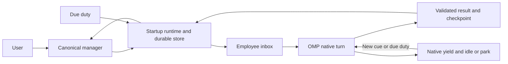

# Startup V6: persistent staff, inbox, and loop

**Status:** Proposed scope, not implemented. V5.0.1 remains the released version.

## Problem and decision

V5 has durable task intake and canonical personas, but explicitly ends workers on queue drain. V6 gives every managed Startup persona a durable employee identity, its own inbox, and a shared loop. An OMP companion extension owns delivery, hiring receipts, wake admission, and schedules. OMP continues to own actual model execution, transcripts, native task isolation, yield, parking, and revival.

Use the native integration candidate as the base, subject to the gates below. Retain the SDK candidate's atomic claim/result design; reject its parallel spawning path as the default. Reject native workpool as the staff roster because it closes on drain. [Versioned research and alternatives](2026-10-13-startup-v6-research.md)

## Usage first

```text
hire devops 6
startup hire devops 6
```

Both mean **add six more DevOps employees** to the selected Startup. With two already hired, the result is eight. The manager can invoke the same canonical hire procedure for additional capacity without another human confirmation. Only the human's accepted request or the bound manager can authorize hiring; other employees request capacity through the manager.

Each new employee has a distinct ID, inbox partition, canonical role binding, native transcript mapping, and checkpoint. Native display names are not employee IDs. A retry of the same hire request returns the same six IDs. Another intentional request, even with identical wording, adds another six.

The hire receipt reports `requested`, `reserved`, `ready`, `starting`, and `failed`, with individual IDs and errors. It says all six are operational only after six actual native bindings and complete source-load receipts exist. A pending activation remains visible and recoverable. Roster size and concurrently running turns are separate limits.

The manager can then assign a standing duty:

```text
DevOps007: monitor the approved production API deployment.
Use the recorded health probe and cadence.
Report deployment transitions, failures, and required decisions to the manager.
```

Target, probe, cadence, and acceptance come from the manager's assignment or existing explicit Startup policy. Missing values keep the duty pending. Hiring alone grants no deployment mutation authority.

## Ownership and components



| Component | Canonical responsibility |
|---|---|
| `skills/hire/SKILL.md` | User and manager hiring procedure, additive counts, and receipt interpretation. |
| `skills/startup-loop/SKILL.md` | One shared persona loop contract, loaded completely with the canonical role. |
| Startup runtime | Employee membership, inbox delivery, claims/results, wake admission, duty occurrences, and actual-handle correlation. |
| Existing role skills | Persona authority, work procedures, output requirements, and manager routing. |
| OMP adapter | Native task dispatch and lifecycle mapping; the only component aware of OMP wire details. |

Proposed implementation package: `extensions/startup/`, with one registration entry, one state owner, one OMP adapter, and generated native profiles. Native profiles select existing canonical skills; they do not contain handwritten persona copies. The package uses OMP's extension-package mechanism. Skills-only installation cannot report persistent staffing as available.

## Startup boot guidance

Every Startup boot ensures `<bound_root>/AGENTS.md` exists beside `<bound_root>/.startup/`. It belongs at the Startup folder root, never inside `.startup/` or the runtime state directory. Include explicit guidance for manager intake, canonical role binding, hiring, the shared loop, supported runtime tools, and the active-harness fallback so the coding harness can discover them on later turns.

Preserve existing AGENTS.md instructions. Add or update one clearly marked Startup section idempotently; unrelated content stays intact. Link canonical installed skill sources and the actual runtime contract instead of copying personas. Child guidance loads its assigned role; it does not turn every child into the manager. New and existing bound Startup folders receive this guidance during boot.

```text
myfolder/
  .startup/
  AGENTS.md
```

## Canonical inbox primitive

Proposed domain operations, not existing OMP APIs:

```text
sendCue(recipient, validatedCue) -> saved message receipt
claimNext(employee) -> one scoped claim or no ready work
settleClaim(claim, validatedResult) -> saved result and outgoing-message receipts
```

Caller identity, Startup namespace, manager root, and generation come from the runtime binding, not model-supplied `from` fields. Scope includes the execution host, named Startup, bound root, and native manager session; `Main` or a display name alone is insufficient. A specialist reads only its own assigned cues through this primitive. Questions and concerns become manager inbox messages. The manager remains the sole user contact and work/merge authority.

Store the new runtime state in `<home>/startup/<name>/staff.sqlite`. One serialized runtime owner uses SQLite transactions. Keep it outside repositories and `tmp/`. The load-bearing records are:

| Record | Identity and invariant |
|---|---|
| Host lease | One current owner per named Startup and manager root; owner epochs fence a superseded process. |
| Employee | Stable employee ID, canonical role/revision, manager scope, employment state, native generation and handle. |
| Hire request | Unique request ID; role and additive count immutable; allocated employee IDs retained across retries. |
| Message | Unique message ID; sender authority, recipient, kind, correlation, payload/artifact references, and sequence. |
| Claim | One active claim per employee; owner epoch and native generation fence stale results. |
| Result | Claim-bound output and evidence; duplicate submission returns the existing receipt. |
| Duty occurrence | Unique `(dutyId, scheduledFor)`; persisted cadence and next due time. |

Save each cue before notifying or waking its recipient. Native IRC is a wake transport, not the durable inbox. Claim a bounded batch before execution. Commit the validated result, incoming acknowledgement, and outgoing manager messages in one transaction. A native terminal event, delivery receipt, or plain final paragraph is not a completed work receipt.

Delivery may replay after a crash. Inspect saved results and the native transcript before retrying. A question acknowledges its delivery while leaving the assignment waiting for the manager. An external mutation with an unknown outcome enters reconciliation; expiry alone does not authorize repeating it.

`queue.json` remains the manager-owned task source. Mail carries an immutable assignment snapshot plus queue item ID and revision; employees cannot edit a competing task queue. The manager records a dispatch ID before enqueueing that assignment and reconciles interrupted handoffs using that ID. Completion collection is idempotent by result ID. Preserve V5 pending requests, IDs, unknown fields, and receipts.

## Canonical loop primitive

The runtime owns the lifetime; the prompt follows the work procedure:

```text
while employee is hired and Startup is active:
    select the next ready inbox cue or due assigned duty
    acquire one execution grant
    load canonical role, shared loop, own checkpoint and current cue
    run one bounded native OMP turn
    validate and persist result, checkpoint and manager messages
    release the execution grant after native settlement
    wait, idle or park until the next cue
```

An empty work queue changes activity to `WAITING`, not employment to `RETIRED`. Every managed persona uses this contract: dev, DevOps, QA, architect, and PA; the singular manager consumes human intake and staff outcomes through its corresponding loop. A result completes an assignment or cycle, not the employee's career.

**Canonical prompt text to add through the shared loop skill:**

```text
You are a hired Startup employee running the canonical loop.
At each wake, read your own assigned inbox cue and saved checkpoint.
Perform the next action authorized by the manager under your canonical role.
Send questions, concerns and required decisions to the manager inbox.
Return the required result and checkpoint through the inbox completion contract.
After an assignment or monitoring cycle finishes, return to the loop's waiting state.
Use native wait when a real wake source exists; otherwise checkpoint and yield
so OMP can idle or park this turn and the runtime can wake the next one.
Continue employment until explicit retirement or Startup shutdown.
```

Native request/runtime budgets still apply. A blocked or budget-limited turn retains its employee and unfinished work but does not spin. An unexpected end without a valid completion leaves the claim unresolved and sends a durable manager alert; it does not acknowledge the cue or retire the employee. Hard-aborted native handles remain terminal; a recorded replacement generation may continue the logical employee after explicit manager recovery.

## Context boundaries

- Each wake receives complete canonical role and loop sources, its own small checkpoint, its active assignment, and necessary artifact references.
- Runtime source-load evidence verifies canonical paths and revisions. Unknown autoload names, missing source, or wrong role prevent duty admission.
- Validate the complete role/loop context on synthetic and revived turns too. `before_agent_start` alone does not cover every synthetic continuation; the adapter may need the native `context` projection hook without rewriting transcript history.
- Keep manager history, other employees' inboxes, raw logs, and code out of ordinary staff wake payloads. Preserve the manager's existing execution firewall.
- Store long-term role memory separately from item evidence. Compact role decisions; load detailed job artifacts only when the current cue requires them.
- Preserve fresh, isolated execution contexts for new code items. Rotate a native generation when an old workspace or item context is unsuitable; preserve the employee ID and prior receipts.
- Canonical role updates are loaded at a safe wake boundary and recorded as a revision change. A model's self-report that it read the skill is not binding proof.

## Native hiring and wake integration

The selected candidate wraps the existing native tool named `task`. Its effective schema accepts either unchanged native task parameters or a typed Startup hire request. The hire branch validates role/count/request identity, reserves the employees transactionally, derives canonical native bootstrap tasks, and delegates through same-name `ctx.invokeTool`. This preserves native dispatch policy and capacity rather than rebuilding them around a lower-level executor.

Example proposed transport shape, **not stock OMP syntax**:

```json
{"startupHire":{"role":"devops","additional":6,"requestId":"hire-event-42"}}
```

The selected Startup and caller authority are runtime-bound; they are not selectable fields in this request. Internally, hiring, native task conversion, and ordinary native delegation are separate single-purpose functions. The extra task schema arm is an accepted integration cost that must be demonstrated compatible before release.

Use the running build's injected namespace for native registry identity. The proposed parked wake path restores the scoped persisted roster, ensures the actual native handle is live, and delivers a native monitored cue. The isolated installed-binary probe confirmed that the registry subpath lifecycle manager shares OMP 18.8.9's native registry and exposes park/revival functions. Actual parked revival remains a release gate. Directly importing the global 17.4.1 package is not that proof.

The delegate exists only in the task tool handler; do not retain it for a timer callback. Pending employees without native handles remain pending after restart until another authorized native dispatch completes their existing hire receipt. Fully automatic activation of such employees requires a supported host dispatch seam and its own release gate. Do not silently substitute a second SDK runner or invent `ctx.agents.spawn`.

## Hire skill contract

Proposed frontmatter:

```yaml
name: hire
description: Use when a user requests additional Startup persona instances or the active Startup manager needs more canonical role capacity.
```

The procedure resolves the active manager and supported runtime, validates a positive safe integer count and existing canonical role, obtains the stable request identity, calls the single runtime hiring path, and reports actual readiness. `devops` resolves to `startup-role-devops`; other aliases resolve from the canonical role registry. Keep exactly one manager. Unknown roles require an existing canonical skill source before hiring; the manager does not invent persona text.

Manager hiring is allowed by the user's standing authorization in this request. It remains subject to the Startup's configured resource and execution limits. Six hires do not mean six unrestricted simultaneous model turns. A later deliberate hire and a retry are distinct events.

## DevOps duty and resource ownership

The manager assigns targets, health probes, cadence, evidence requirements, and repair authority. Persist due occurrences. Successful unchanged deterministic checks update observation history; transitions, failures, and decisions wake the responsible DevOps employee. Six employees can receive different targets or assignments; they do not all automatically mutate the same deployment.

Finishing a repair returns DevOps to its standing monitoring duty. Monitor/check/coordinate instructions do not grant repair, provision, restart, or deploy authority. Same-target authorized mutations require one runtime-owned exclusive grant before action and post-action verification before release.

V6 must have one resource-lock writer. Migrate existing held resource locks conservatively into the runtime's grant owner; preserve inventory and history from `resources.json`, then make its lock view a projection. Ambiguous held locks block the affected target until reconciled. A target-aware mutation connector can enforce grants; unrestricted shell actions remain outside that guarantee. Do not describe prompt-only lock instructions as runtime enforcement.

Managed timers operate while the canonical OMP host is running. After host exit, activity is `OFFLINE` and deployment health is unknown until another check. Restart restores staff and pending cues, coalesces missed read-only polls into one recorded observation per duty, and never claims checks occurred during downtime. An always-on host service is a separate deployment decision, not implicit in this scope.

## Scope and delivery gates

| Stage | Concrete deliverable and exit condition |
|---|---|
| 0: Native feasibility | On the installed binary, prove task schema wrapping/delegation, actual role preload including synthetic wakes, root-bound metadata, native yield/park/wake, and shared registry singleton. Prove the restricted tool/connector path needed by the chosen duty. Stop dependent implementation if these fail. |
| 1: Runtime primitives | One owner and transaction store for employees, hire receipts, inbox claims/results, context references, execution grants, and due occurrences. No model-owned mailbox rewrites. |
| 2: Canonical skills | Add `hire` and `startup-loop`; update manager and every role's lifetime contract, dispatch reference, status, PA reminders, and installer. Boot creates root AGENTS.md beside .startup and preserves existing guidance. Generated OMP profiles bind canonical source; remove contradictory V5 exit-on-drain text. |
| 3: Behavioral proof | Demonstrate add-six with existing staff, exact retry recovery, queue-drain persistence, a second assignment, periodic health duty, context isolation, crash recovery, partial hiring, and serialized target repairs. |
| 4: V6 release | Package/link the OMP companion, preserve/migrate V5 state, publish the tested capability/version boundary, then bump VERSION/changelog and release V6.0.0. |

The first supported target is the installed OMP 18.8.9, subject to Stage 0. Upstream 18.10.4 is comparison evidence, not an assumed installed upgrade. Other or unidentified harnesses use a disclosed prompt-only fallback with canonical role instructions and their supported subagent tools; persistent agents and scheduled monitoring require a proven adapter.

Stage 0 is partially investigated: an isolated probe with zero model calls demonstrated same-name task delegation into native validation, root-session correlation, shared lifecycle registry, and managed timer execution. Valid task compatibility, complete canonical role loading, synthetic wakes, actual yield/park/revival, and the chosen duty's restricted operation path remain open. [Installed-interface evidence](2026-10-13-startup-v6-research.md#installed-interface-probe-2026-10-13)

## Acceptance and honest guarantees

- `hire devops 6` adds exactly six identities; existing staff remain; retry adds zero; a new deliberate request adds six more.
- A hire cannot report six ready employees without six source-verified native bindings. Partial launches retain their original IDs and reasons.
- Every managed persona survives task queue drain logically, accepts later assigned cues, and routes questions upward.
- Durable cues cannot be acknowledged solely by transport delivery; crashes and late-generation results do not silently lose or duplicate completed work.
- Monitoring uses real scheduled wakes, records health evidence, resumes after authorized repair, and serializes admitted same-target mutations.
- Context snapshots preserve role identity without copying the whole manager/team history into every wake.
- Native OMP execution, task policy, isolation, budgets, transcript ownership, and status identity are proven for the release target.
- The runtime can enforce admission, identity, message accounting, and mediated operations. Persona reasoning, task quality, and arbitrary tools outside that mediation still require the existing review and verification procedures.

## Tradeoffs and first implementation step

The companion extension adds packaging and local state in exchange for mechanically accountable staffing and mail. Bounded native turns allow idle/parked employees; they do not keep an exited process alive. The task schema wrapper preserves native dispatch but creates a compatibility obligation. A separate SDK supervisor would expose more native execution policy to maintain and is not selected.

First implementation step: finish the Stage 0 operational compatibility spike on OMP 18.8.9 before writing the runtime or shipping the new skills. The temporary interface probe was removed after its evidence was recorded. No persistent runtime code, installation, model-backed probe, version bump, or V6 release occurred during this scoping work.
