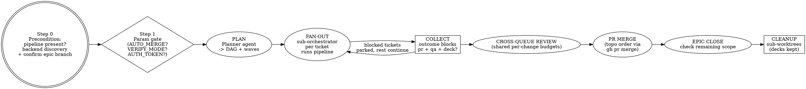

# Dark Factory

## Execution backend
Use the bounded host and its real dispatch, nesting and review tools as specified in the shared workflow policy. The coordinator owns the frozen queue and assignment state; the ledger below is only a reporting view. Its documented capability blockers take precedence over any later pane or fan-out instruction. Herdr and Tern are optional presentation backends, not substitutes for coordinator receipts.

Startup is optional and independent of the pane backend. Use an already selected Startup only
when the user wants it; never create, select, install, boot, or hire a Startup to run the
factory. If none is active, run the factory directly. The user can choose `STARTUP_MODE=off`
even when a Startup exists. An active Startup may enforce its own root admission: use an
independent non-Startup root rather than bypassing its runtime guards or changing its state.
If no such root can be launched, report the concrete launch blocker, not a Startup prerequisite.

Before dispatch, read the shared authority at the installed `jp-pipeline` skill's `references/workflow-policy.md`, or `$JP_SKILLS_REPO/skills/jp-pipeline/references/workflow-policy.md`. Apply its scope, crew and inherited per-change review budget.

## Overview

One **principal orchestrator** freezes the selected ticket queue in the bounded host and dispatches one
**sub-orchestrator** per ticket; each runs `jp-pipeline` within its inherited scope and reports a bounded outcome.
The principal merges in topological order and closes the epic only when its whole scope is complete.

Scale rule: run ticket implementation and verification in parallel. Defer ticket reviews to cross-queue review before any merge. Each review round consumes one from each covered change's shared budget; honor any stricter inherited cap. Fix actionable findings and verify; re-review updated changes when budget remains, stopping on APPROVE.

Resolve `jp-pipeline` from the installed registry or the configured skills checkout. If unavailable, recover access while continuing independent intake and planning; use the shared coordinator and preserve the user's requested verification and landing gates.

**Non-negotiable constraints:**
1. **Pipeline access (Step 0).** Recover the installed or configured source if unavailable; continue independent work during recovery.
2. **Context firewall (section 3).** The principal never reads file bodies, full diffs, full
   logs, or full ticket descriptions. Sub-orchestrators read only their pipeline's outcome
   blocks, never code. Everything heavy happens inside pipeline runs.
3. **Bounded review before landing.** Ticket pipelines defer review; the principal coordinates cross-queue review, fixes actionable findings through the crew and verifies them. Stop at APPROVE or the inherited per-change cap.
4. **Shared settings once.** Resolve verification mode and routine choices from the request and defaults, then propagate them to every pipeline. Ask once only when an essential decision cannot be resolved from context.
5. **One auth token, held centrally.** `AUTH_TOKEN` (session cookie / bearer token) is supplied
   once, held by the principal, and propagated to every ticket pipeline for QA. It travels via
   env only, never lands in files, logs, ledger, or outcome blocks. Pipelines whose QA needs no
   auth ignore it; a missing/expired token bubbles up as a single question, not one per ticket.
6. **No red merges, no force-push to `main`, no permission/settings changes.** Ever.
7. **Never manually merge ticket branches.** Ticket work lands via `gh pr merge` in
   topological order only. The orchestrator worktree is bookkeeping space, never modified.
8. **No silent scope creep.** Decisions are escalated or become Linear `follow-up` tickets
   under the epic, never silent inline expansion.
9. **Every ticket proves itself.** No ticket is done without its pipeline's QA pass and deck
   path in the outcome block - pre-merge, post-merge, or both per section 5.4.
10. **Principal owns layout.** In a selected pane backend, use one run-owned pane per worker;
    record its identity and let only the principal allocate or close it. In-process workers
    need no terminal backend.

## When to Use

- You have a Linear epic with child tickets and want it shipped end-to-end with minimal supervision.
- You have several related tickets that should each get the full pipeline treatment in parallel.
- You want parallelism across tickets without blowing out a single context window.

## When NOT to Use

- **One ticket** -> use `jp-pipeline` directly; the factory overhead buys nothing.
- **One small, obvious change** -> just do it; the swarm overhead is not worth it.
- **You want a code review, not changes** -> use `jp-architecture-audit` or `jp-pr-review-toolkit`.
- **No git repo / no Linear access** -> the skill requires both.
- **The work must not touch `main`** -> set `AUTO_MERGE=false`, or do not use this skill.

## 1. Inputs / Parameters

The only required input is the Linear task ID. Everything else has a default; confirm them at the parameter gate (Step 1).

| Parameter | Default | Meaning |
|-----------|---------|---------|
| `LINEAR_TASK_ID` | (required arg) | The Linear epic/task to ship, e.g. `SYT-987`. |
| `TARGET_BRANCH` | `main` | Where each child ticket PR is merged. Propagated as each pipeline's `target`. |
| `MAX_PARALLEL` | `6` | Cap on concurrent sub-orchestrators. Each pipeline manages its own internal width; this caps tickets in flight. |
| `AUTO_MERGE` | `true` | Principal merges each clean child PR in topo order. Set `false` only when the user requests no merge; leave PRs open and report them. |
| `VERIFY_MODE` | `local` | `local` / `ci-only`. Honor an explicit user constraint and propagate the selected mode to every pipeline. |
| `AUTH_TOKEN` | (empty) | Optional session cookie / bearer token for QA, supplied once and propagated via an approved environment channel. Needed for authenticated preview or deployed proof. If absent or expired, one question bubbles up; record only its disposition, never the value. |
| `WORKTREE_MODE` | `local` | `local` (git worktree under `<home>/worktrees/<repo>/<branch>` per the `jp-pipeline` Step 1b contract, where `<home>` is `$JP_SKILLS_HOME` else `$XDG_CONFIG_HOME/jp-skills` else `~/.config/jp-skills`) or `vm` (Conductor `{worktree_id: vm_ip}`). Pipelines create their own trees there; the orchestrator checkout stays bookkeeping-only. |
| `STACK_MODE` | `auto` | `auto` (stack along DAG edges with `--base` chains, fall back to flat with reason) / `stacked` (fail loudly instead of falling back) / `flat` (current behavior: every PR targets `TARGET_BRANCH`). |
| `BACKEND` | `auto` | `auto` selects compatible Herdr inside Herdr, otherwise reachable Tern, otherwise `in-process`; `herdr`, `tern`, or `in-process` selects explicitly. If a selected backend cannot safely launch a worker, use in-process and record why. |
| `STARTUP_MODE` | `auto` | `auto` may use an already selected Startup, otherwise runs standalone; `off` runs independently even if one exists. Never boot or select a Startup for this factory. |

The factory selects its per-change review cap before dispatch, at most three and subject to any stricter inherited cap. Each pipeline owns its ticket's QA; newly discovered follow-ups are recorded for a separate run.

> **Merge gate:** if `AUTO_MERGE=false`, stop after all pipelines report with PRs open and report
> their URLs + deck paths. **Never** force-push to `main`; **never** merge a red build under any setting.

## 2. Factory flow



## Step 0 - Precondition and epic branch (blocking)

1. **Resolve `jp-pipeline`.** Check the installed registry and configured skills checkout. Repair a missing link when authorized; continue independent intake and planning while recovering access. Preserve coordinator state and required review and verification gates.
2. **Discover the execution backend.** Resolve `BACKEND` before dispatch. In `auto`, prefer
   Herdr only when `HERDR_ENV=1` and its server/API preflight succeeds; otherwise use Tern
   when `tern` is installed and its session is reachable, else use in-process. Explicit
   `herdr` or `tern` attempts that backend and falls back in-process if unavailable, recording
   the reason. No install recommendation or terminal is required. Do not control Herdr from
   outside Herdr. Read `references/herdr-panes.md` for Herdr or
   `references/tern-panes.md` for Tern before any pane operation. Discover only; allocate
   after the parameter gate. Record the selected backend and its run-owned identifiers.
   Resolve `STARTUP_MODE` separately: use an existing Startup only when selected and not opted
   out; otherwise run directly. A missing Startup never blocks the pipeline. For `off`, verify
   the worker launch excludes automatic Startup extension loading; use the selected backend's
   instructions. Do not mutate or shut down an existing Startup.
3. **Confirm the current branch** with `git rev-parse --abbrev-ref HEAD`. This is the
   orchestrator's branch, already set to the epic's Linear branch name by the user. Note it in
   the ledger as the context anchor. **Do not rename, create, or check out any branch here.**
4. **Fetch the task** with the Linear MCP: `get_issue` with `id = LINEAR_TASK_ID`,
   `includeRelations: true`. Read **only** identifier + title (truncate to <=6 words) into the
   ledger. Do **not** read the description body - that is the Planner agent's job (section 5.1).
5. **Plan the factory task crew** under the shared policy: manager/coordinator, architect, developer(s), and QA, reusing eligible inherited roles. After the queue is frozen in Step 5.1, reserve and dispatch through the host. Add PA/DevOps only when needed.
6. **Confirm** to the user: resolved task identifier + title, current branch, selected backend
   and worker agent where applicable, and that the `jp-pipeline` precondition passed.
   Then proceed to the parameter gate.

## Step 1 - Resolve parameters

Before dispatch, resolve the parameters from the request and defaults. Ask only for information needed to proceed:

1. **`AUTO_MERGE`** - `true` (principal merges each clean child PR to `TARGET_BRANCH` in topo
   order) vs `false` (pipelines run with `don't merge`; PRs left open for manual review).
   Default `true`; set `false` when the user requests no merge. Do not ask for merge approval.
2. **`MAX_PARALLEL`** - confirm the sub-orchestrator width matches the available worktree/VM pool.
3. **`VERIFY_MODE`** - `local` (every pipeline runs the full local gate) vs `ci-only` (every
   pipeline defers to CI). Default to local; honor the user's explicit mode and propagate it to all pipeline calls.
4. **`AUTH_TOKEN`** - reuse a supplied or available authorized session for authenticated QA. If a required credential is unavailable, ask once and continue independent work while waiting. Record only `token: provided (redacted)`, never the value.
5. **Linear team** - the team under which sub-orchestrators file `follow-up` / `qa-found`
   tickets (resolve via `list_issue_labels`/team metadata if not obvious from the task).
6. **`STACK_MODE`** - `auto` (stack along DAG edges, flat fallback) vs `stacked` (no fallback — stacking failure stops and escalates) vs `flat` (every PR targets `TARGET_BRANCH`, pre-patch behavior). Default `auto`.
7. **`BACKEND`** - `auto`, `herdr`, `tern`, or `in-process` as defined above. Resolve once;
   terminal failure falls back in-process without duplicating an active worker.
8. **`WORKER_AGENT`** - for Herdr, `same` or a supported installed agent kind; for Tern,
   `omp` (the supported launch recipe in `references/tern-panes.md`). Require the executable
   on `PATH`; otherwise use in-process. In-process uses the host's subagent mechanism.
9. **`PANE_LAYOUT` / `PANE_FOCUS`** - Herdr supports the layouts and focus options in
   `references/herdr-panes.md`. Tern uses a tab per worker in the selected session; it does
   not promise background focus. If that would disturb the user, choose in-process.
10. **`WORKER_TIMEOUT`** - milliseconds before inspecting a stalled worker; default `7200000`.

Decide backend and Startup mode once at this gate; never re-ask per ticket. The user may set
`STARTUP_MODE=off` at invocation or change it before dispatch.

Start independent planning as soon as the necessary scope is known; resolve optional settings and actual dependencies in parallel.

For noninteractive fan-out, resolve shared values here and include the resolved parameter
manifest in every sub-orchestrator brief. Include the target or stack parent, merge ownership,
verify mode, worktree mode, stack mode, Startup mode, auth disposition, and shared scope decisions. Never pass
`verify-mode ask` onward or assume a child can recover an answer from this conversation. Resolve shared settings from context and defaults; ask once only when a necessary decision remains unavailable, then propagate it unchanged. `MAX_PARALLEL` is an upper
bound, not a promise that the runtime can start that many agents; inspect live agent capacity,
including supervisors and reviewers, before choosing each wave. This run hit the three-agent cap
with a supervisor and two workers; the supervisor yielded and resumed after capacity opened.
Evidence: `ledger.md` and `runrecords/feasibility.md` in the SYT-9093 run record.

## 3. The Context Firewall (read this twice)

This is the whole point. Violating it is the only way this fails.

**The principal MUST NOT:**
- Read file bodies, full diffs, full test output, full build logs, or full ticket descriptions
  into its own context.
- Implement, edit, or review code itself, or dispatch implement/fix agents directly. All work
  goes through sub-orchestrators running `jp-pipeline`.
- Merge ticket branches into the orchestrator worktree - not via `git merge`, not via
  cherry-pick, not via any other mechanism.
- Echo a sub-orchestrator's verbose output back into its reasoning. Outcome blocks only.

**Sub-orchestrators MUST NOT:**
- Read code, diffs, or logs themselves either. They invoke `jp-pipeline`, enforce its outcome
  schema, and bubble questions upward. Code blindness holds at both layers.

**You MUST:**
- Delegate *all* heavy reading to pipeline runs. Even epic decomposition's deep dive goes to a
  Planner agent - you keep only the DAG.
- Require every sub-orchestrator to return the **bounded outcome schema** (section 4). A malformed result goes back to the same owner for correction; it is not permission to start another pipeline.
- Keep a concise operational view (section 4 table) of ticket handles and decisions; it does not authorize dispatch or replace coordinator state.
- Refer to everything large by **handle**: branch name, worktree id, Linear ticket id, PR
  number, deck path, or a Linear comment URL. Never by content. The token is never a handle -
  it is never written down anywhere except the ask itself.

If you ever feel the urge to "just look at the file to be sure" - don't. That question belongs
to a ticket's pipeline, not to you.

## 4. The Ledger and outcome schema

### Operational view

Maintain this table for reporting. One row per ticket; coordinator state remains authoritative for admission, reservations, completion and review budgets.

| Ticket | Title (<=6 words) | Wave | Sub-orchestrator | Pane | Pipeline | PR | Deck | Deps | Status | Residual risk (<=12 words) |
|--------|-------------------|------|------------------|------|----------|----|------|------|--------|----------------------------|

`Pane` is `<backend>:<worker>@<pane-or-block-id>` in pane mode, or `in-process`. Record
the run header once with backend, session/window where applicable, worker agent and layout;
record fallback reasons without secrets.

`Status` is one of `QUEUED | PIPELINE_RUNNING | PR_OPEN | MERGED | BLOCKED`.

Also keep three short lists:
- **Open questions** - `{from, question, status}` - anything bubbled up from sub-orchestrators.
- **Rebase conflicts** - `{pr, branch, status}` - PRs that conflicted on merge and need a rebase agent.
- **Follow-ups** - `{linear_id, source (follow-up | qa-found)}`, newly discovered work outside this run's fixed queue.

The ledger records `verify-mode`, `token: provided (redacted)` or `token: none`, and shared
answers - never the token value itself.

When a row hits `MERGED`, collapse it to `[done] <ticket>` (keeping its deck path in the final report) and drop its risk note.

### Sub-orchestrator Outcome Schema (enforce strictly)

Every sub-orchestrator must end its turn with **exactly** this block and nothing verbose before it:

```
=== SUB-ORCHESTRATOR OUTCOME ===
ticket:          SYT-xxx
status:          DONE | BLOCKED | NEEDS_DECISION | IN_PROGRESS
pr:              <ready PR URL | none + reason>
verify-mode:     <local | ci-only>
backend:         <herdr | tern | in-process>
head:            <exact tested PR head SHA | none + reason>
checks:          <PASS | FAIL | PENDING + required check state at head>
review:          <PENDING_FINAL | COMPLETE | BLOCKED>
qa:              <PASS | FAIL | BLOCKED | PENDING + brief evidence or reason>
deck:            <absolute copy-out path | none + reason>
followups:       <linear ids filed for out-of-scope work, or none>
remaining:       <=2 lines: anything not fixed and why
blocked_on:      <ticket/decision, or none>
=== END ===
```

**DONE requires** a ready PR URL, QA PASS, a delivered deck path, and all required checks
completed on the reported head. The factory's cross-queue review must also be complete and its
actionable findings fixed before the epic is complete. BLOCKED or NEEDS_DECISION outcomes must
name the reason and preserve the pending result. A missing artifact is never an inferred pass.

`IN_PROGRESS` is a nonterminal outcome, not a reason to re-dispatch. Keep the ledger row at
`PIPELINE_RUNNING`, preserve the same sub-orchestrator, pipeline owner, worktree and exact pending
evidence, and wait for or resume that owner. Do not start a second pipeline for the ticket. Keep
the row out of `PR_OPEN` until its existing completion predicate is satisfied.

Request correction from the same owner for any nonconforming outcome. You read **only** the corrected block.

## 5. Phase details

### 5.1 INTAKE + PLAN

1. **Fetch children** with the selected tracker connection. Freeze the selected ticket IDs as this run's fixed queue with `bounded_begin` before dispatch; in OMP omit dependencies for Planner registration. Record exclusions in the reporting view. If the task has **no children**, use the parent as the sole item and retain the same graph and review gates.
2. **Dispatch one Planner agent** through the selected host as specified in the shared policy: OMP uses bounded `task` with `planner: true`; Claude uses `bounded_plan` and one foreground `Agent` with its marker. Planning is extraction and topological sorting, not synthesis; a missed soft dep degrades to a rebase conflict the factory already recovers from. The Planner deep-reads each child, including its body, work branch and relations, and the relevant code, and returns:
   - per-ticket acceptance criteria distilled to <=3 bullets,
   - per-ticket `gitBranchName` (the work branch for that ticket),
   - a **dependency DAG** (hard deps from Linear `blocks`/`blockedBy` + soft deps from predicted shared-file contention),
   - a **wave assignment** (topological layers) honoring `MAX_PARALLEL`,
   - a **stack chain** along hard deps (same repo): each blocked ticket's work branch bases on its blocker parent's branch; independent tickets stay flat on `TARGET_BRANCH`. Record per-ticket `stack-mode: stacked|flat (+ reason)` in the ledger.
   Its correlated terminal result must include `dependencies` and `targets` maps for every frozen ticket, alongside the compact DAG, waves and branch names. The host validates and freezes those maps; wait for `bounded_status` to show `graphFrozen` before ticket dispatch. Collect only its structured planning result, not implementation output.
   When using Linear GraphQL directly, read the branch from its actual `branchName` field; do
   not copy a connector-normalized `gitBranchName` name into a GraphQL query. Verify the active
   tool schema before issuing metadata queries. Evidence: `syt-9096-run.md` and
   `sidebar/pipeline.md` in the SYT-9093 run record.
   Trace acceptance claims to the original user decision or handoff. Treat generated-ticket
   requirements as assumptions until that trace exists. Before calling an upstream capability
   missing, inspect the current shipped CLI, API, docs, or runtime; distinguish a supported
   composition path from the exact owner contract that remains absent. Keep tickets open while
   evidence is incomplete; mark them blocked only when a required dependency is demonstrated to
   be unavailable. Evidence: `runrecords/feasibility.md` in the SYT-9093 run record.
3. Populate the ledger.

### 5.2 FAN-OUT (one sub-orchestrator per ticket runs `jp-pipeline`)

For each wave, in dependency order:
- Refresh live agent state before filling a wave. When a capacity error occurs, do not retry
  against a stale slot count. Have the supervisor yield while workers run, wait for bounded
  completion notifications, then resume and refresh capacity. Keep status updates short; an idle
  supervisor must not hold a slot. Evidence: `sidebar/pipeline.md` and
  `runrecords/feasibility.md` in the SYT-9093 run record.
- Launch up to `MAX_PARALLEL` workers per wave using the selected backend reference:
  `references/herdr-panes.md` or `references/tern-panes.md`. Record every allocated identity.
  Pane cwd is the orchestrator checkout; each pipeline creates its own worktree under
  `<home>/worktrees/<repo>/<branch>` in local mode or uses Conductor in vm mode. Use the
  ticket's `gitBranchName`. In-process uses the same brief and outcome schema.
- Launch same-wave workers concurrently and collect only their bounded outcomes. Inspect stalled
  or blocked workers using the selected reference; do not equate idle with successful completion.
  On failure, reconcile ownership and process state before retrying or falling back. A ticket
  must never have a live pane worker and an in-process worker at the same time.
- Give each sub-orchestrator the **Sub-orchestrator Brief** (section 6) with the invocation:
  ticket id + `target {{STACK_PARENT}}` (stack-parent branch when chained, else
  `{{TARGET_BRANCH}}`) + `don't merge` + `verify-mode {{VERIFY_MODE}}`. If supplied, pass
  `AUTH_TOKEN` only through an approved environment channel; omit it otherwise.
- Copy every resolved shared value and decision into the brief. A noninteractive child call must
  not depend on an earlier interactive gate in the principal's chat. Resolve shared values from the request and defaults before
  dispatch and pass the selected value; keep secrets in the approved environment channel.
- Same-wave sub-orchestrators run concurrently. Collect outcome blocks. A ticket is not
  `PR_OPEN` until its outcome shows a real ready PR URL, `checks: PASS` on the exact head,
  `qa: PASS`, and a delivered deck path. Review is pending until all implementation
  is ready for the factory-wide review.
- Register each genuinely QA-backed ready PR with `bounded_ready` before scheduling dependents. Final completion and cross-queue review remain separate.
- `IN_PROGRESS` -> keep the same ledger row `PIPELINE_RUNNING` with its owner and worktree;
  preserve the exact head and pending check/QA/review/artifact states, then wait for or resume that
  owner for the next outcome. Never re-dispatch a second pipeline for the ticket.
- `BLOCKED` / `NEEDS_DECISION` -> park the ticket, surface the one-liner to the user, continue
  with the rest. Shared questions (expired token, scope calls affecting siblings) are answered
  once and recorded, not re-asked per ticket.

**Fixed queue.** Follow-up or QA tickets discovered after intake are recorded and reported,
not scheduled in this run. They can form a separately authorized future run. Re-polling may
identify outstanding work for an accurate epic-closure decision, but never expands this queue.

**Final review:** Once all implementation waves and their required checks are complete, dispatch `jp-pr-review-toolkit` across the full set of changes before merging any ticket. Track each round against every covered change's inherited budget. Fix actionable findings and run affected checks; when budget remains, review the updated changes and stop on their first APPROVE. At the cap, report fixes as unreviewed and hold only landing if a required approval or finding remains unresolved; continue independent work. BLOCK stops landing; never invent an APPROVE.

### 5.3 COLLECT (owned by the outcome schema, not by you)

The principal collects implementation and verification outcomes. Review is deferred to the
factory-wide review after all implementation is ready:

- For DONE, require `pr: <ready URL>`, `qa: PASS`, a delivered `deck:` path, all required checks
  completed successfully on the exact reported PR head (`checks: PASS`).
- For BLOCKED or NEEDS_DECISION, require an explicit blocker or decision and the actual PR, QA,
  check, and deck states. `none` or `PENDING` is valid when explained; it never becomes a pass.
- Record final-review findings and fix actionable defects before declaring the epic complete.

Collect per the selected backend reference or the in-process result; request a corrected block
from the same owner, never dispatch a second pipeline.

If an outcome is `BLOCKED` / `NEEDS_DECISION`, investigate and resolve the issue using available evidence and authorized alternatives. Return a corrected brief to the owner and continue independent tickets. Ask the user only for a decision or permission that is actually needed and cannot be resolved from context.

If CI is red after a DONE outcome (a race with a post-push check): dispatch a **targeted Fix
agent** on that ticket's worktree with the specific failing CI output (handle only - no raw
logs). It fixes, re-verifies in the ticket's `verify-mode`, and pushes. You only read its
one-line result. In pane mode use a run-owned ephemeral pane per the selected reference; retain
it on failure and close only after successful collection.

### 5.4 PR MERGE (topological order; skipped when `AUTO_MERGE=false`)

Merge ticket PRs in topological order (no PR is merged before all its `blocks`/`blockedBy` deps are `MERGED`):

1. For each eligible PR: verify CI is green, then run `gh pr merge <PR> --squash --delete-branch` (or `--merge` per repo convention). Abort and surface the failure if red.
  **Stacked children:** after each parent merge, retarget each direct child onto the merged line (`gh pr edit <child> --base {{TARGET_BRANCH}}`), re-green in its `verify-mode`, then merge it. Stacking failure (base unsupported, protection blocks it) → flat fallback for that child: rebase onto `{{TARGET_BRANCH}}`, record the reason, continue.
2. **Conflict on merge:** if `gh pr merge` fails due to conflict (the PR branch is behind `TARGET_BRANCH` after previous merges):
   - Dispatch a **Rebase agent**. The rebase is mechanical: on that ticket's worktree run
     `git fetch origin {{TARGET_BRANCH}} && git rebase origin/{{TARGET_BRANCH}}`, resolve
     conflicts, re-verify in the ticket's `verify-mode`, and force-push the branch only. If a review of the reconciled change is required, use only remaining per-change budget; otherwise report reconciliation as unreviewed and honor the landing gate. In pane mode use a run-owned
     ephemeral pane, collect the one-line result, and close only on success.
   - Structural or ambiguous conflict -> inspect both histories and affected behavior, resolve within the authorized scope, verify, and continue independent tickets. Ask only if an essential decision cannot be determined.
3. Mark the ticket `MERGED` in the ledger. Collapse the row (deck path retained for the report).
4. **Sync the orchestrator branch with `TARGET_BRANCH`** after each merge: `git fetch origin && git rebase origin/{{TARGET_BRANCH}}`. Resolve any conflicts directly - do not dispatch an agent for this. The orchestrator branch carries no code changes, so conflicts are rare and always local. Resolve, then continue.
5. Record newly discovered follow-ups without adding them to this run's fixed queue.
6. **Post-merge QA where required.** Pipelines ran with `don't merge`, so their QA proved the
   worktree/preview. Any ticket whose proof is only meaningful post-merge or post-deploy
   (authed production path, deploy-gated behavior) gets a post-merge pass: re-dispatch its
   sub-orchestrator to run that ticket pipeline's Step 9 against the merged `TARGET_BRANCH`
   with `AUTH_TOKEN` via the approved environment channel (asking once if absent). A post-merge QA
   failure becomes a `follow-up` ticket under the epic, never a silent patch to main.
### 5.4b STACK DRIVER (standing merge-accelerator)

One dedicated sub-agent per run whose whole mission is getting code merged faster. Dispatched at FAN-OUT, alive until EPIC CLOSE. It checks in with the principal and sub-orchestrators through the selected backend's channel on every outcome arrival and merge — never implements, never reviews, never merges itself.

- Owns all stack traffic: verifies each chained PR's base, retargets children after parent merges (`gh pr edit --base`), rebases stale branches, re-greens in the ticket's `verify-mode`, and pushes branch-only force-pushes.
- Owns the flat fallback: when stacking is unavailable (host lacks `--base` chains, protection rules block it), drops that child to flat on `{{TARGET_BRANCH}}` and records the reason in the ledger — never stalls the run waiting for stack support.
- Reports per-ticket `stack-mode` + merge-readiness to the principal in ≤5 lines; the principal still issues every `gh pr merge`.
- In pane mode it uses its own run-owned pane. Use the selected backend's communication and
  collection procedure for handle-only check-ins and read at most its five-line report. It
  never allocates panes.

### 5.5 EPIC CLOSE

Runs only when every fixed-queue ledger row is `MERGED` and required post-merge QA passes.

1. **Check remaining scope:** re-poll children for unfinished work outside the fixed queue.
   If any remains, leave the epic open and report those IDs; do not schedule them in this run.
2. **Close the epic** only when its whole scope is complete: `save_issue` with `id = LINEAR_TASK_ID`, `stateId = <done state id>` (resolve via `list_issue_statuses` for the team). Add a comment via `save_comment` summarizing what shipped, with PR + deck links per ticket.
3. If `AUTO_MERGE=false` (PRs opened but not merged), skip epic closure and instead ping the user with all PR URLs and deck paths for manual review and merge.

### 5.6 CLEANUP (always, even on partial failure)

- Verify the deck copy-out and its required assets before removing any worktree. Remove only
  task-owned worktrees for merged tickets after the durable deck is verified. Keep open,
  unmerged, blocked, and in-progress worktrees so their changes remain recoverable. Delete only
  the corresponding merged local branch. Preserve source fixtures, screenshots, logs, and
  receipts that are part of the proof record; clean only task-owned temporary outputs after their
  durable copy is verified. From outside the tree, use `git worktree remove <path>` followed by
  `git worktree prune`; use `git branch -d <branch>` only for the corresponding merged branch.
  Record what was removed and what remains. Evidence:
  `sidebar/cleanup.json` and `composer/completed-cleanup.json` in the SYT-9093 run record.
- Do not remove the orchestrator checkout. Do not delete shared caches, another task's worktree,
  or another task's process. Confirm owned preview servers/listeners are stopped. Measure reclaimed
  disk where cleanup is material; one verified merged-worktree cleanup in this run reclaimed
  about 1.02 GiB while preserving its deck and leaving other worktrees and processes untouched.
- Verify `git worktree list` against the remaining open or active tickets, not a blanket rule that
  only the orchestrator worktree may remain.
- Close only the Herdr or Tern panes/tabs/workspaces this run created and recorded. Keep
  blocked or failed workers open for inspection. Never close the caller's or another client's
  resources or stop a shared server, daemon, or session.
- In `vm` mode, return Conductor VMs to the pool.
- Emit the final report (section 9).

## 6. Sub-orchestrator Brief (the fan-out unit - paste per sub-orchestrator)

> You own **{{TICKET}}** end to end. Run the `jp-pipeline` skill on it with exactly these
> overrides: `target {{TARGET_BRANCH}}`, `don't merge`, `verify-mode {{VERIFY_MODE}}`.
> Shared parameter manifest: {{SHARED_PARAMETER_MANIFEST}}. These values are resolved; do not
> ask the user to repeat a shared parameter or inherit it from an earlier chat turn.
> Open the PR as ready, never draft (`gh pr ready` in the same step if the repo defaults to drafts). The merge decision is unchanged: `AUTO_MERGE=false` still stops at open PRs (now open-ready).
> Acceptance criteria: {{AC}}. Work branch: the ticket's Linear `gitBranchName`. If supplied,
> obtain `AUTH_TOKEN` from the approved environment channel, never the brief.
> Stacking: `target` above names the stack-parent branch when the principal chains this ticket (open the PR with `--base <parent>`), else `{{TARGET_BRANCH}}`. Commit early and often (per slice/wave, per fix batch — small logical commits, message states decision/why); push promptly so stacked children can base on real commits.
> Backend: {{BACKEND}}. The principal owns any pane or tab; do not create, move, rename, or
> close terminal resources. Report the resolved backend on the outcome's `backend:` line.
> In-process workers use the host's subagent channel. Startup mode: {{STARTUP_MODE}}; never
> create, select, or boot a Startup. Do not recommend installing a terminal.
> 1. **Run the pipeline, do not freelance.** Invoke `jp-pipeline` with the ticket id and the
>    overrides above, including `review: deferred to factory-wide review` and the inherited per-change budget. Never
>    start per-ticket or intermediate reviews. The pipeline's task crew
>    handles implementation and QA. Your job is invocation, question-routing, and outcome enforcement.
> 2. **Route questions upward.** Your pipeline's supervisor will surface batched questions
>    (session tokens, scope calls, verify-mode edge cases). Answer what is ticket-local yourself
>    only if it is unambiguous; bubble everything else using the selected backend's channel
>    with a one-liner. If your pipeline's QA needs an auth token and none was supplied, bubble one
>    shared question - never invent, borrow, or log a token yourself. Never let your pipeline
>    stall silently waiting.
> 3. **Enforce the outcome.** When the pipeline finishes, collect its final report and convert
>    it to the **Outcome Schema** (section 4): PR URL, verify-mode, exact PR head, check state,
>    final-review disposition, QA result, absolute deck path, and followups. If a DONE outcome
>    lacks any required value, it is a protocol violation - say so, do not paper over it.
> 4. **File follow-up work in Linear** for anything the pipeline reports as out of scope (extra
>    refactors, newly found bugs, prerequisite work) that is not already filed. Use `save_issue`
>    with `parentId = {{EPIC_ID}}`, `team = {{TEAM}}`, `labels = ["follow-up", <severity>]`, and
>    a self-contained description. Report the IDs; they remain outside this fixed run.
> 5. End with the **Outcome block** (section 4) and nothing more. Keep prose minimal - only the
>    block is read.

## 7. QA (per ticket, inside each pipeline - no background agent)

There is no epic-level background QA agent. Each ticket's pipeline proves itself with real data
and leaves a slide deck (pipeline Step 9), pre-merge against its worktree/preview. The
principal's QA job is verification of outcomes, not testing:

1. Every DONE outcome must carry `qa: pass` plus the failing-proof detail on any other value.
2. Every DONE outcome must carry an existing absolute `deck:` path.
   States unreachable against a live env (error states, destructive paths, edge cases) are proven
   per ticket in the repo's component workshop (Storybook, Ladle, or equivalent) with stories on
   the actual changed files - workshop renders are captured evidence in the deck, labeled with
   their source. Standalone mockups never count.
3. Tickets whose proof is only meaningful post-merge/post-deploy get the 5.4 item-6 pass with
   `AUTH_TOKEN` after the principal merges.
4. Defects found by any QA pass that exceed the ticket's scope arrive as `followups`; record
   their IDs for a separately authorized run rather than expanding this run's fixed queue.

Epic closure cannot proceed while any ticket lacks its required QA pass or a deck.

## 8. Guardrails

- **Parallelism:** never exceed `MAX_PARALLEL` live sub-orchestrators or the actual agent-slot
  capacity. Refresh live state after a capacity error. Supervisors yield while workers run and
  resume from short completion notifications; reviewers are scheduled in bounded batches when
  slots are limited. Reviewers participate in the bounded factory-wide review.
- **One ticket, one pipeline, one worktree.** Never two pipelines on the same ticket or branch.
  Overlap creates conflicts you then pay to resolve.
- **One writer per repository.** Separate worktrees do not separate two lanes that both add
  migrations, regenerate the same clients, or bump the same manifest, so serialize those even when
  the tickets are unrelated. A lane whose work lives in a *different* repository can run in parallel
  meanwhile. Record a repo-lock name per lane and start the next one only after the holder finishes,
  because two concurrent writers on one schema or manifest produce competing PRs and a lane that
  correctly stops on the conflict.
- **A parked ticket never ends the run.** An ownership conflict, a missing ACK, or an unavailable
  dependency parks that ticket only. The principal dispatches other eligible tickets in the same
  turn. Ending a turn with zero deliverables while unclaimed tickets exist is a stall, not a wait;
  check the counts (`ready`, `merged`) rather than the pane status before believing a run is busy.
- **Land reviewed work before dispatching anything new.** After the final cross-queue review, each turn lists open
  PRs across affected repos and merges each one that is ready, exact-head green and reviewed;
  a mergeable PR left open while new lanes spin up is the dominant way a factory burns a day and
  delivers nothing. `merged` is the only number that measures the run; `ready` and `in flight` are
  inventory, not output. When the run cannot merge a green PR (repo forbids the strategy, base
  protection, stacked PR), say which PR and why in the same turn instead of leaving it to age.
- **Size verification to the change, not to the monorepo.** A full-workspace gate is correct for a
  shared package and wrong for a one-file slice: a monorepo-wide typecheck plus a 15k-test API suite
  makes every small ticket inherit every unrelated breakage, so lanes finish their work, fail on a
  gate they cannot fix, and open nothing. Default a ticket lane to the affected workspace's
  typecheck/tests/builds plus exact-head CI, and keep the full gate for changes that touch shared
  code, the lockfile, or build config. Prove the specific gate you own and record the full gate's
  known-red baseline as its own ticket rather than letting it veto every PR.
- **A turn budget is a silent stop.** A cyclic supervisor that exhausts its allowed turns simply
  stops producing outcomes; nothing inside the run reports it, so the program looks busy while dead.
  Size the budget to the program's length, have the watchdog surface exhaustion as an owner-facing
  event, and never rely on an agent status field or a written outcome to notice the halt.
- **Wave 1 does not wait on the planner.** If the DAG is missing, incomplete, or the planner session
  died, derive the initial runnable set from live tracker state and start it; the planner only refines
  later waves. A planning step that must finish first turns one flaky agent into a whole-run outage.
- **Supervise the principal from outside.** A single principal turn is not durable: when the process
  exits or hangs, nothing inside the run starts the next turn, and helper sessions created by that
  turn die with it. Run a deterministic watchdog that continues the principal while eligible work
  remains, and reports lanes it cannot revive.
- **Token hygiene:** the token travels principal -> sub-orchestrator -> pipeline supervisor via
  an approved environment channel only, never prompt, terminal input, command arguments, files,
  logs, ledger, outcome blocks, or Linear. If secure propagation is unavailable, use an
  appropriate in-process channel or stop the affected QA and surface the blocker.
- **Model tiers:** clerical agents use cheaper/faster agents. Pipelines run on the session
  default; never downgrade a run that writes application code.
- **Idempotency:** sub-orchestrators must be resumable - re-running on a partially-done ticket
  re-enters its pipeline safely. Step 0's checks are idempotent.
- **No silent scope creep:** unclear ticket -> `NEEDS_DECISION`, not improvisation.
- **Shared questions once:** `VERIFY_MODE` and `AUTH_TOKEN` are decided at the gate and
  propagated. Any question whose answer would apply to every ticket is answered once, recorded
  in the ledger, and never re-asked.
- **Structured Linear writes:** read fresh complete descriptions, prepare and validate full
  intended payloads before mutation, preserve unrelated criteria and dependency edges, persist
  each write receipt, then fresh-read and verify every result. If bounded payload preparation
  fails, start from a fresh read and structured rewrite instead of stacking brittle parser fixes.
  If a write outcome is uncertain, read to reconcile it; never retry the mutation through another
  connector. Resolve the target issue's UUID from its identifier in the same step as the mutation;
  a wrong-but-valid UUID carried from earlier context succeeds silently on the wrong record and the
  readback looks healthy. Normalize only observed formatting differences during readback comparison. Evidence:
  `runrecords/ownership-lesson.md`, `ownership-payloads.json`, `ownership-write-*.json`, and
  `ownership-verification.json` in the SYT-9093 run record.
- **No red merges, no force-push to `TARGET_BRANCH`, no permission/settings changes.**
- **No manual branch merges:** ticket branches land via `gh pr merge` only.
- **Recovery:** investigate repeated blockers and structural conflicts, try supported alternatives, and continue independent tickets. Ask the user only when an essential decision or authorization cannot be resolved from available evidence.
- **Context:** if any outcome block exceeds the schema, ask its existing owner to correct it. Protect your context.
- **Stack driver owns stack traffic, principal owns merges.** The driver retargets, rebases, and re-greens; it never runs `gh pr merge` itself. No second driver per run.
- **Flat is always a valid fallback.** Stacking failure records a reason and continues flat — never a stall, never a silent unstacked merge of a chained child (retarget first, then merge).
- **Backend isolation:** Herdr pane commands require `HERDR_ENV=1`; Tern uses only recorded
  run-owned blocks. Neither is required for in-process work.
- **One live agent per pane.** Avoid focus changes where supported; if Tern's focus behavior is
  unsuitable, use in-process. Never close resources this run did not create or stop shared daemons.
- **Pane output is not context.** Read only the bounded outcome or outcome file.
- **A stalled worker is inspected, not duplicated.** Reconcile process state before retry or
  in-process fallback; Herdr `agent_not_ready` is not a reason to relaunch.

## 8b. Recurring-block escalation (do not let lanes languish)

When three or more lanes end an outcome with the same gate in different words - a red full local gate,
a broken shared workflow, an unqualified template - the factory is blocked on its **base**, not on its
work. Widening the fan-out against a red base produces evidence and no merges.

The response is one move, in the same turn:

1. **Park the fan-out.** Dispatch no new tickets until the base is green.
2. **Spawn one dedicated unblock lane** with an explicit mission, exclusive paths, and a written
   definition of green (exact command, exit code, evidence). It owns the base; nobody else edits it.
3. **Amend the principal's brief** so it cannot dispatch a second baseline lane, and narrow it to
   collecting and landing what is already green.
4. **Register the unblock lane with the watchdog** so a dead or hung unblocker is restarted like any
   other lane, and raise the principal's turn budget if it exhausted.

Check the environmental cause before accepting a lane's blocker: a CI failure reported as "runner disk
full" or a missing mount is host state, not code, and re-running it after cleanup is often the whole
fix. Verify the host rather than inheriting the lane's diagnosis.

**An architecture change halts the run before anything else is edited.** When the owner reverses a
decision every lane depends on - deployment target, runtime, template shape - stop the lanes first,
keeping worktrees and branches intact. Persist the decision as `STOP-<topic>.md` in the run directory,
append a superseded banner to every lane brief, and say plainly that lanes were **stopped**, not
messaged: a running non-interactive agent cannot take a mid-run instruction, so killing the process and
re-briefing is the only honest way to redirect it. Touch the shared artifact (template, shared CI,
config schema) only after the halt, or two lanes and the orchestrator will write the old shape into it
concurrently.

**A halt is not done until the scheduler is paused and the count is re-checked.** Stopping lanes leaves
whatever cron or watchdog started them alive, and its next tick relaunches work the owner just told you
to stop - a "stopped" factory that quietly resumed is worse than one that never stopped. In the same
turn: pause the factory's watchdog and alert jobs, stop the lanes, verify the process count, and
re-check once after one scheduling interval has passed before reporting the halt as complete.

## 8c. Ship one slice end-to-end before you fan out

A factory distributes work whose path is already known. It cannot discover a delivery path nobody has
walked, and a run whose definition of done includes *deployed* or *live* will produce evidence and zero
deliverables if the path is missing: every lane finishes its own code, fails the same missing step, and
parks.

- **Prove one unit end-to-end first.** One lane, one target: build the artifact, provision whatever
  resource it needs, deploy through CI, and read the live result back from the provider's API. Write the
  steps down as a runbook the later lanes copy verbatim, and have the first lane correct the runbook
  wherever it was wrong so the second unit inherits the fix.
- **Separate "not implemented" from "no delivery path".** A lane that completes its work and still cannot
  ship is telling you the path is broken. Answer that by fixing the path - not by dispatching more lanes,
  and not by another document.
- **Classify a deploy blocker before relaying it.** When lanes park on missing configuration, sort it into
  what the orchestrator may create itself (service-internal keys it can generate, per-service bindings,
  resource ids, a repository that must exist before a lane can stamp it) and what stays owner-gated
  (third-party API keys, identity-provider decisions, a DNS cutover). Provision the first class in the
  same turn and report the second as a named list; an unclassified "blocked: needs secrets" reads
  identically for both and stalls the whole run behind one question.
- **Distribute merges where ordering does not matter.** Reserving every merge at the principal is right
  for stacked chains and multiple PRs on one repo/branch, and wrong for N independent repos: it
  serializes the whole run behind one context. A lane that owns a distinct repo merges its own green PR
  and reports the merge commit.
- **Report measured counts, not activity.** Owner-facing status is `deployed`, `live`, `merged` - read
  from the provider and the VCS by the orchestrator, never inferred from lane self-reports. A CI job that
  concludes success while its deploy steps were skipped is the standard fake-green; confirm a real
  version exists and is serving before counting it.
- **Probe the provider, never parse the outcome for status.** Re-derive every lane's state by hitting its
  live URL and recording the observed status code. An outcome block is a claim, and a loose substring test
  (`"deployed:" in text and "none + reason" not in tail`) silently counts `deployed: none; blocked by
  missing secrets` as a deployment - the count then reads 17 deployed while 9 answer. Keep the probe as
  the single source of truth and re-derive the whole fleet after any change to the supervisor's parsing.
- **A stall answered with coordination is this skill's characteristic failure.** When the owner says work
  is slow, the fix is more execution along the proven path (fan the proven step out wide), not more
  briefs, ledgers, or supervisors. If the next action cannot be parallelized because the path is
  unproven, say that in one line and prove the path instead.

## 9. Final Report (to the user)

**Report lift and counts, never timeframes.** Owners of long runs ask what is left and what it costs in
work, not when it lands: give sites/files/services and the shape of each remaining step ("N lanes, M
blocked on X, three steps left: template, migrate, deploy"), and if a schedule is genuinely requested,
name the dependency instead of a date. An ETA guessed from lane activity is the fastest way to lose
trust in the rest of the report.

A single compact summary: epic id, `verify-mode` used for all tickets, `token: provided
(redacted)` or `token: none`, per-ticket `stack-mode: stacked|flat (+ reason)`, tickets DONE,
BLOCKED, NEEDS_DECISION, and still in progress, all PR URLs with their current open/merged state,
the final review results and per-change budgets, per-ticket QA (pre/post-merge), exact-head CI state and deck path, follow-up tickets
filed for a future run, epic closed in Linear (y/n), which merged sub-worktrees were cleaned,
`backend` and fallback reasons, `worker-agent`, panes left open,
and any escalations needing a decision. No transcripts. Pending checks remain pending; a PR with successful checks is not DONE without its
required review and QA evidence.

## Quick Reference

| Phase | Who runs | What the principal keeps |
|-------|----------|-----------------------------|
| Step 0 precondition + branch | Main thread (skill check + backend discovery + git + Linear MCP) | pipeline-present boolean, backend and owned ids, epic id, title, current branch |
| Pane lifecycle | Principal only (allocate, launch, prompt, collect, close) | tab/pane ids per ticket |
| Step 1 param gate | Main thread + user | `AUTO_MERGE`, `MAX_PARALLEL`, `VERIFY_MODE`, `AUTH_TOKEN` (redacted), team, `STACK_MODE`, `BACKEND`, worker and applicable pane settings |
| PLAN | Planner agent (own pane in pane mode) | DAG + waves + stack chains + per-ticket branches |
| FAN-OUT | Sub-orchestrators (parallel, each runs `jp-pipeline`) + stack driver | Outcome blocks + PR URLs + per-ticket stack-mode + pane ids |
| Scope check | Main thread (Linear MCP) | remaining IDs outside the fixed queue |
| COLLECT | Main thread (schema check + `gh pr checks`) | per-ticket done/blocked state |
| PR MERGE | Stack driver preps, principal issues `gh pr merge` (topo order) | PR merge status + retargets + post-merge QA passes |
| EPIC CLOSE | Main thread (Linear MCP) | closure confirmation |
| CLEANUP | Main thread | sub-worktree-clean boolean + deck paths + panes closed/kept |

## Common Mistakes

- **Abandoning work on a missing skill.** Recover the configured pipeline source and continue independent work while access is restored.
- **Reading code/diffs/logs into your own context.** The single failure mode. Delegate everything heavy; consume only outcome blocks.
- **Implementing, reviewing, or QA-ing at the principal layer.** Pipelines own all three. The principal coordinates, merges, and verifies outcomes.
- **Letting a sub-orchestrator freelance.** It runs `jp-pipeline` with the brief's overrides. A sub-orchestrator that implements directly has broken the pattern - discard and re-dispatch.
- **Merging inside ticket pipelines.** Pipelines run with `don't merge`; all merges happen at 5.4 in topo order. A merged ticket PR breaks ordering guarantees.
- **Accepting mockups as workshop proof.** Workshop stories must exercise the actual changed files. A standalone recreation of the look is not verification.
- **Asking shared questions per ticket.** `VERIFY_MODE` and `AUTH_TOKEN` are decided once at the gate and propagated. Per-ticket repeats burn context and risk divergent answers.
- **Logging or persisting the token.** It travels only through an approved environment channel and is recorded only as `provided (redacted)`. Any disclosure requires rotation.
- **Inferring completion from an incomplete outcome.** DONE requires a ready PR URL,
  QA PASS, a delivered deck, and completed exact-head checks. BLOCKED and NEEDS_DECISION outcomes
  may lack these artifacts when they state why; preserve that status instead of inventing a pass.
- **Manually merging ticket branches into the orchestrator worktree.** Never run `git merge` on a ticket branch. All merges happen via `gh pr merge`. The orchestrator worktree's branch is never modified.
- **Merging on `AUTO_MERGE=false`.** That mode stops at open PRs plus deck paths. The user must explicitly request this mode.
- **Closing the epic without checking remaining scope.** Re-poll and leave it open if work outside the fixed queue remains.
- **Expanding the fixed queue mid-run.** Record new follow-ups for a separately authorized run.
- **Skipping post-merge QA for deploy-gated tickets.** Pre-merge proof does not cover post-merge behavior. Tickets that need it get the 5.4 item-6 pass with the token.
- **Two pipelines on the same ticket or branch.** One ticket, one pipeline, one worktree.
- **Removing worktrees before verifying deck copy-out paths.** Decks live outside the worktrees by pipeline contract - confirm each absolute path first, then remove.
- **Deleting the orchestrator worktree.** Cleanup only removes pipeline sub-worktrees. The orchestrator worktree is the user's responsibility.
- **Cleaning up unfinished work.** Remove task-owned merged worktrees only after the durable deck
  is verified. Keep open, blocked, and in-progress worktrees recoverable; clean owned temporary
  outputs after copying the evidence they support.
- **Accepting a draft PR as DONE.** Every outcome PR is ready (`gh pr ready` repair when the repo defaults to drafts); draft is a protocol violation like "none".
- **Merging a stacked child before its parent.** Merge bottom-up; retarget the child (`gh pr edit --base`) + re-green before merging it.
- **Stacking tickets that share no dep edge.** Independent tickets stay flat on `TARGET_BRANCH`; chains follow hard DAG deps only.
- **Fanning out before the delivery path exists.** When the definition of done includes a deploy, prove
  one unit from repo to live first; otherwise every lane parks on the same missing step and the run
  reports effort instead of output.
- **Counting green CI as delivery.** Read a real deployed version back from the provider. A job that
  skips its deploy steps and concludes success is the most common way a run "ships" nothing.
- **Counting a health 200 as a working service.** A liveness endpoint proves the process exists, not
  that it serves its product: an unstamped skeleton answers health checks and 404s every real route.
  Report health and domain-verified paths as two numbers, and probe a real route taken from that
  service's own router.
- **Assuming a lane branch inherits the current shared CI.** A branch cut before a canonical workflow
  landed still carries the old workflow, so its PR fails on plumbing the lane cannot fix and the
  failure hides the lane's real work. Push the canonical workflow file onto that branch before
  diagnosing its code, and close PRs whose only content is superseded plumbing.
- **Treating a second checkout as harmless.** A stale clone beside the lane worktree is a second
  writer even though it is not a worktree: two processes editing the same schema file is exactly the
  conflict the one-writer rule exists to prevent. Park any duplicate directory before relaunching a
  repository lane, and key repo locks on the repository, not the worktree path.
- **Controlling Herdr from outside Herdr.** Use Tern or in-process instead.
- **Letting workers allocate panes.** One pane per worker, principal-owned.
- **Reading a pane's implementation output.** Outcome block or outcome file only.
- **Stealing focus.** Use a backend whose focus behavior is acceptable, or use in-process.
- **Closing a tab the run did not create.** Record and close only your own ids.
- **Running a ticket both in a pane and in-process.** One execution path per ticket.

$ARGUMENTS

## Framework tail
Before finishing, read `../jp-cleanup/SKILL.md` (relative to this skill's repo directory; fallback `$JP_SKILLS_REPO/skills/jp-cleanup/SKILL.md`) and follow it.
